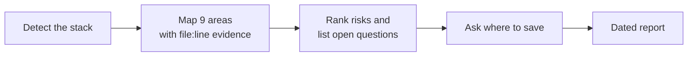

# System Understanding

A read-only skill for AI coding agents that maps how a codebase works before anyone changes it.

Changing code you don't understand is how things break: an auth check gets skipped, a background job silently
stops, a feature behind a flag gets switched on by accident. Agents change code fast, and they change the wrong
thing just as fast. This skill makes the agent read first.

Point it at a repo and you get:

- **A map of the system.** Structure, the auth flow, APIs and data flow, background jobs, serverless functions and
  cloud workflows, the database, branding, feature flags and routes.
- **Evidence for every claim.** Each finding cites a file and line. Anything the agent couldn't see is marked
  **Not found**, and anything it worked out indirectly is marked **Inferred**.
- **Risks and open questions**, saved as a dated report your team can keep, share and compare with later runs.

It doesn't change anything. The only file it writes is the report, and it asks where to put it first.

## Quick start

**Claude Code:** save [`SKILL.md`](SKILL.md) as `.claude/skills/system-understanding/SKILL.md` in your project.
On macOS, Linux or Git Bash:

```bash
mkdir -p .claude/skills/system-understanding
curl -o .claude/skills/system-understanding/SKILL.md \
  https://raw.githubusercontent.com/singhtirath143-source/system-understanding-skill/main/SKILL.md
```

Then ask: *"Understand this codebase before we change anything."*

**Any other agent:** paste the contents of `SKILL.md` as the prompt, followed by *"Run this on this repository."*

## What a report looks like

From the [full example report](examples/nextjs-postgres-auth-starter.md), made by running the skill on a public
open-source starter app:

> **Top 3 risks**
> 1. **Duplicate accounts are possible.** The `User` table has no unique constraint on `email`, and sign-up
>    checks then inserts in two separate steps (`app/db.ts:36-40`, `app/register/page.tsx:12-17`).
> 2. **No brute-force protection on sign-in.** No rate limiting or lockout anywhere (Not found; see §9).
> 3. **The protected page relies on middleware alone.** `app/protected/page.tsx` renders even when there's no
>    session; only `middleware.ts` keeps signed-out visitors away.

## How it works



The skill reads manifests, config and imports to learn the real stack, so it fits any language or framework. An
area that doesn't apply (say, there's no database) still gets one line in the report saying why.

## What the report covers

| # | Section | What's in it |
|---|---|---|
| 0 | Summary | What the system is, the top 3 risks, a stack table, and what was and wasn't read |
| 1 | Project structure | Frontend, backend, middleware order, environment variables (names only), build and test commands, CI |
| 2 | Auth flow | Sign-in to backend validation as numbered steps, every auth file, auth risks |
| 3 | API and data flow | Every endpoint with its auth and validation, the main user flows end to end, external services |
| 4 | Background work and cloud | Workers, queues, schedules, serverless functions (e.g. Azure Function Apps, AWS Lambda), workflows (e.g. Logic Apps, Step Functions), webhooks, infrastructure as code |
| 5 | Database | Tables and fields, where the schema is defined, access rules, mismatches between the schema and the code |
| 6 | Branding | Hardcoded names, logos, theme values, URLs |
| 7 | Feature flags | Where flags are defined and checked, and what they gate |
| 8 | Routing | Public, signed-in, admin and dynamic routes, guards, 404 handling, broken links |
| 9 | Risks | Critical and moderate, each with evidence |
| 10 | Open questions | Things only a person on the team can answer |

## How it stays safe

- **Read only.** The agent reads files, searches and runs read-only git commands. It doesn't install packages,
  run builds or migrations, start the app or call external services.
- **Report, don't fix.** It names problems so a person can decide what to do. It doesn't propose fixes or write
  code.
- **No secrets.** Environment variables and keys appear by name only, never their values.
- **The live cloud is opt-in.** By default it reads only the repo. If you explicitly ask it to look at deployed
  cloud resources too, it uses only list / show / describe commands. It never creates, changes, starts or
  triggers anything, and never runs commands that return secrets.

These are instructions to the agent, not technical enforcement. For a hard guarantee, run the agent where it
must ask before editing files or running commands, and approve only the report file.

## Limitations

- **It reads code; it doesn't run it.** Runtime behaviour, live data and library defaults are labelled Inferred,
  not proven.
- **It sees what's in the repo.** Cloud resources built in a portal show up as "Not in repo" unless you opt in to
  read-only cloud commands.
- **It's a map, not an audit.** It names the risks it finds while mapping, but it doesn't replace a security
  review or tests.
- **Results depend on the agent running it.** On a very large codebase one agent may only sample some areas; the
  report's coverage note says which.

## Install

### Claude Code

Copy `SKILL.md` into a folder named `system-understanding`:

- **This project only:** `.claude/skills/system-understanding/SKILL.md`
- **All your projects:** `~/.claude/skills/system-understanding/SKILL.md`

Ask "understand this codebase" or "map the architecture before we change anything", or run
`/system-understanding`.

### Other agents

`SKILL.md` is plain Markdown, so it works with any agent that accepts instructions:

- paste its contents as the prompt, followed by "Run this on this repository"; or
- save it in the repo and point the agent's instruction file (e.g. `AGENTS.md`, `.github/copilot-instructions.md`,
  `.cursor/rules/`) at it.

## Where the report goes

Writing the report is the one change the skill makes, so if you haven't said where to put it, it asks first. It
suggests `docs/system-understanding/YYYY-MM-DD-system-understanding.md` in the project, or a folder outside the
repo if nothing in it may change. Each run writes a new dated file. If an earlier report exists, the new one
includes a "Changed since last report" section.

## License

[MIT](LICENSE)
